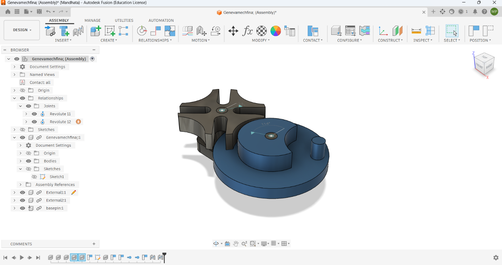
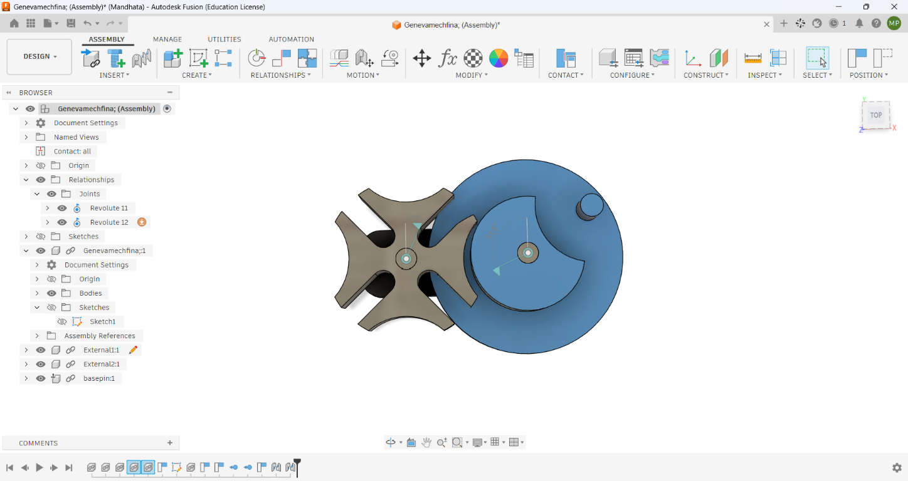
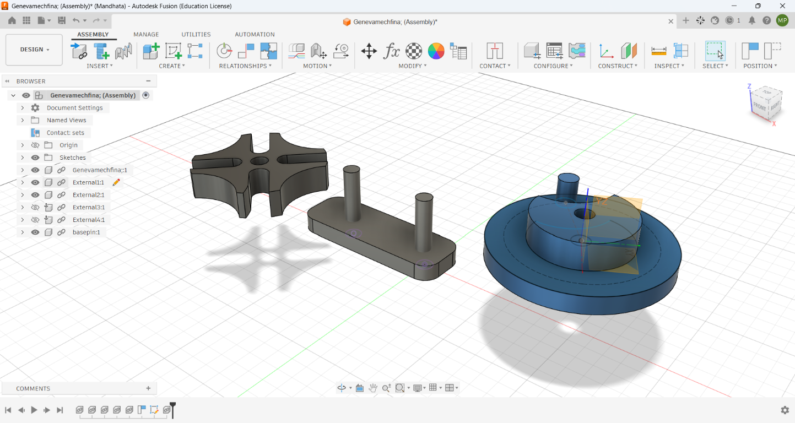
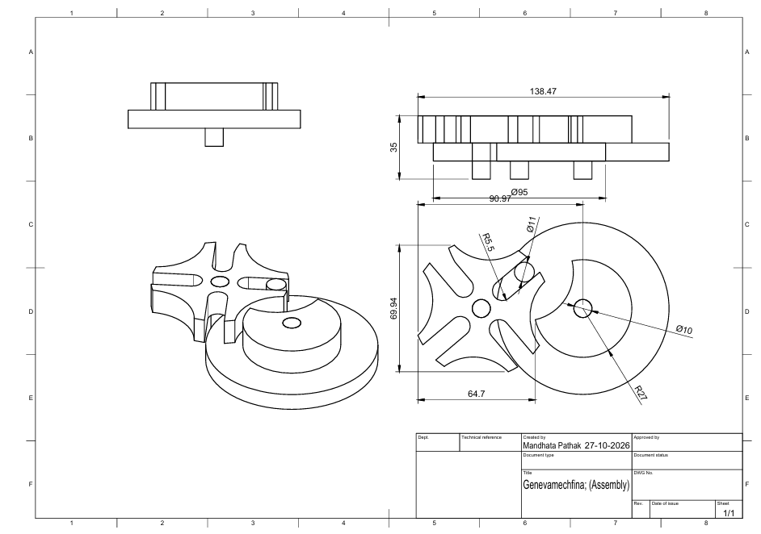
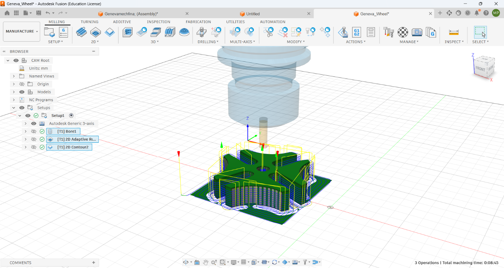

# ⚙️ Four-Slot Geneva Mechanism: CAD Modeling, CAM Toolpath Optimization & Fanuc G-Code Generation

An end-to-end mechanical engineering portfolio project demonstrating parametric CAD design, top-down assembly kinematics, unified CAM toolpath synthesis, collision-free tool geometry optimization, and post-processing for a **DN Solutions (Doosan) 3-Axis VMC with Fanuc Controller**.

## 📌 Executive Summary

This repository documents the complete design-to-manufacturing lifecycle of a **Four-Slot Geneva Mechanism** (Geneva Cross). The system converts continuous rotary motion into precise $90^\circ$ intermittent indexing motion. Designed and engineered in **Autodesk Fusion 360**, this project bridges virtual CAD modeling with real-world VMC manufacturing constraints.

### Key Highlights:

- **Kinematic Design:** 4-slot Geneva wheel with integrated locking arc to prevent back-lash/drift during dwell.

- **Assembly Integration:** Parametric center-to-center distance locked at $56\text{ mm}$ across twin $35\text{ mm}$ cylindrical mounting rods.

- **Collision-Free CAM:** Resolved real-world `Stock+Holder` and `Stock+Shaft` collision errors by enforcing strict tool hierarchy geometry ($\text{Stickout} > \text{Shoulder} > \text{Flute}$).

- **Production G-Code:** Fully validated Fanuc-compatible NC programs (`O1003` / `O1004`) generated via custom post-processor settings.

## 📐 Key Engineering Specifications

| Parameter                   | Value / Specification                                   | Functional Rationale                                         |
| --------------------------- | ------------------------------------------------------- | ------------------------------------------------------------ |
| **Mechanism Type**          | External 4-Slot Geneva Indexing                         | Converts continuous input to $90^\circ$ step rotary output   |
| **Axis Pitch Distance**     | $56.00\text{ mm}$ ($\pm 0.015\text{ mm}$)               | Center distance between driving and driven shafts            |
| **Shaft Height / Diameter** | $35.00\text{ mm}$ / $\varnothing 10.00\text{ mm}$       | Supports wheel rotation with clearance fits                  |
| **Base Plate Size**         | $120\text{ mm} \times 60\text{ mm} \times 10\text{ mm}$ | Rigid mounting base for VMC vice clamping                    |
| **Target Machine Tool**     | DN Solutions 3-Axis VMC                                 | Generic 3-Axis Milling Center                                |
| **CNC Controller**          | Fanuc Series 0i / 31i Control                           | Industry-standard CNC G-code dialect                         |
| **Primary Tooling**         | $\varnothing 6\text{ mm}$ Flat Endmill (`#1 - ⌀6mm`)    | Unified cutter across facing, boring, adaptive, & contouring |
| **Program IDs**             | `O1003` / `O1004`                                       | Fanuc program headers                                        |

## 🏗️ CAD Modeling & Kinematic Assembly Workflow

```
[ 2D Parametric Sketch ] ➔ [ 3D Feature Extrusion ] ➔ [ Joint Constraints & Motion ] ➔ [ Reference Decoupling ]

```

### 1. Parametric 2D Sketching

- **Plane Selection:** $XY$ Construction Plane ($Z$-axis perpendicular).

- **Geometric Constraints:** Coincident centerlines, symmetric slot apertures, horizontal/vertical axis locks.

- **Driving Geometry:** Pitch circle radius calculated to ensure smooth tangential entry of the driver pin into the $90^\circ$ radial slot at engagement.

### 2. 3D Feature Creation

- **Base Plate:** $120\text{ mm} \times 60\text{ mm}$ rectangle extruded $-10\text{ mm}$ downwards ($Z=0$ established on top face). $R=5\text{ mm}$ corner fillets applied.

- **Twin Shafts:** $\varnothing 10\text{ mm}$ circular profiles extruded $+35\text{ mm}$ upwards from the top base plane.

- **Driven & Driver Wheels:** Radial slot cutouts, center bores, and $180^\circ$ locking crescent profiles generated via Extrude Cut.

### 3. Assembly & Reference Resolution

- **Rigid Joints (`J`):** Mated wheel center bores to base shafts to lock rotational axes.

- **Break Link Optimization:** Resolved cross-file reference warnings (`! Assembly References`) when isolating components for CAM processing by selecting **`Break Link`** on external nodes to decouple geometry from broken parent contexts.

## 🛠️ CAM Toolpath Strategy & Machining Sequence

All operations use a single $\varnothing 6\text{ mm}$ **Solid Carbide Flat Endmill** to minimize tool change downtime ($M06$) on the shop floor.

```
┌─────────────────┐     ┌─────────────────┐     ┌─────────────────┐     ┌─────────────────┐
│     2D FACE     │ ──► │      BORE       │ ──► │  2D ADAPTIVE    │ ──► │   2D CONTOUR    │
│  (Top Surface)  │     │  (Center Holes) │     │ (Bulk Roughing) │     │ (Wall Finishing)│
└─────────────────┘     └─────────────────┘     └─────────────────┘     └─────────────────┘

```

### Operations Breakdown:

1. **`2D Face` (Top Clearance):**
   - _Purpose:_ Removes $+1\text{ mm}$ raw stock top allowance to establish an accurate flat surface at $Z=0$.

   - _Parameters:_ $4.2\text{ mm}$ stepover, multiple passes, bottom height tied to `Model Top`.

2. **`Bore` (Helical Hole Interpolation):**
   - _Purpose:_ Opens center mounting shaft holes without heavy axial thrust forces or chip packing.

   - _Parameters:_ $1.0\text{ mm}$ helical pitch spiral entry.

3. **`2D Adaptive Clearing` (High-Speed Roughing):**
   - _Purpose:_ Clears bulk material around $35\text{ mm}$ shafts and Geneva slots while maintaining a constant radial engagement angle.

   - _Parameters:_ $1.5\text{ mm}$ maximum roughing stepdown, $0.2\text{ mm}$ radial stock to leave for finishing.

4. **`2D Contour` (Finishing & Profile Cutout):**
   - _Purpose:_ Final side-wall sizing and perimeter cutoff.

   - _Parameters:_ $1.5\text{ mm}$ stepdown passes, $3\text{ mm} \times 1.5\text{ mm}$ holding tabs to prevent part breakout under cutting pressure.

## 💥 Collision Troubleshooting & Tool Hierarchy Rule

During initial simulation of **2D Adaptive Clearing**, the software flagged severe collision errors:

- `Collision: Stock + Holder`

- `Collision: Stock + Shaft`

### Root Cause Analysis

Machining the $10\text{ mm}$ base plate required plunging down next to $35\text{ mm}$ tall cylindrical shafts (total depth $45\text{ mm}$). The default tool stickout ($42\text{ mm}$) caused the non-cutting metal toolholder to crash into the top of un-machined raw stock.

### Engineering Resolution Rule

Enforced the mandatory carbide tool hierarchy equation in Fusion 360's Tool Library:

$$
\text{Overall Length } (80\text{ mm}) > \text{Length Below Holder } (50\text{ mm}) > \text{Shoulder Length } (42\text{ mm}) > \text{Flute Length } (38\text{ mm})
$$

```
          ┌──────────────┐ ◄── Toolholder Face
          │              │
          │   SHOULDER   │ ◄── 42mm Relieved Neck
          │   (42 mm)    │
STICKOUT  │              │
(50 mm)   ├──────────────┤
          │              │
          │    FLUTE     │ ◄── 38mm Cutting Edge (Clears 35mm Shaft + Stock)
          │   (38 mm)    │
          └──────────────┘ ◄── Tool Tip (Z = -45mm)

```

**Result:** Timeline status turned **100% Green** with zero collisions during full-speed simulation.

## 📜 Post-Processing & Fanuc G-Code Verification

Generated G-code (`.nc`) was verified for syntax, modal safety headers, work coordinate offsets ($G54$), tool length compensation ($G43$), and clean program termination ($M30$).

```
%
O1003 (BASE_PLATE_MACHINING)
(MACHINE: DN SOLUTIONS VMC - FANUC CONTROL)
(TOOL: T1 D=6. - 6MM FLAT ENDMILL - STICKOUT=50MM)
N10 G21 G90 G40 G80          (Metric, Absolute Mode, Cancel Compensation/Cycles)
N15 G30 G91 Z0.              (Safe Z Retract to Reference Point)
N20 T1 M06                   (Tool Change: Tool #1)
N25 S2500 M03                (Spindle ON Clockwise @ 2500 RPM)
N30 G54 G00 X41.56 Y1.205    (Activate Work Offset G54, Rapid to initial XY)
N35 G43 H01 Z15. M08         (Tool Length Comp Active H01, Z15mm clearance, Coolant ON)
N40 G01 Z-0.4 F333.          (Linear plunge pass at 333 mm/min feed)
N45 G18 G03 X40.96 Z-1. I-0.6 F1000. (Helical Arc Entry in ZX plane)
...
[1500+ LINES OF HIGH-SPEED ADAPTIVE STEPDOWNS & FINISHING CONTOURS]
...
N1490 M05 M09                (Spindle Stop, Coolant OFF)
N1495 G28 Z0.                (Safe Spindle Retract)
N1500 M30                    (Program End & Reset)
%

```

## 🖼️ Project Images

### Completed Assembly





### Components and Technical Drawing





### CAM Toolpaths



## 🎥 Video Demonstrations & Simulation Media

Watch the CAD/CAM demonstrations on YouTube:

- [Video 1](https://youtu.be/7NTDfD-v1_g)
- [Video 2](https://youtu.be/UCBCjPq7WeE)
